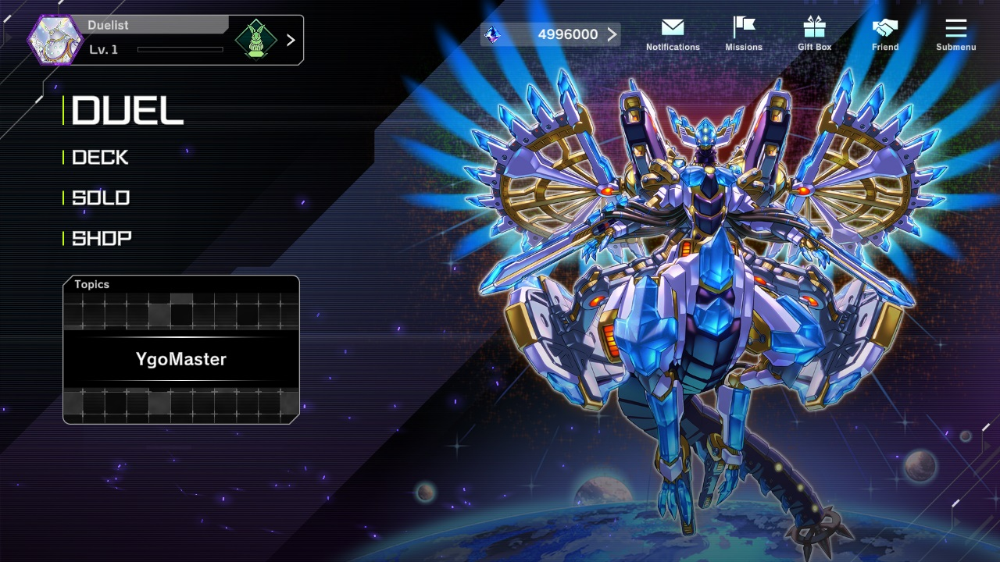
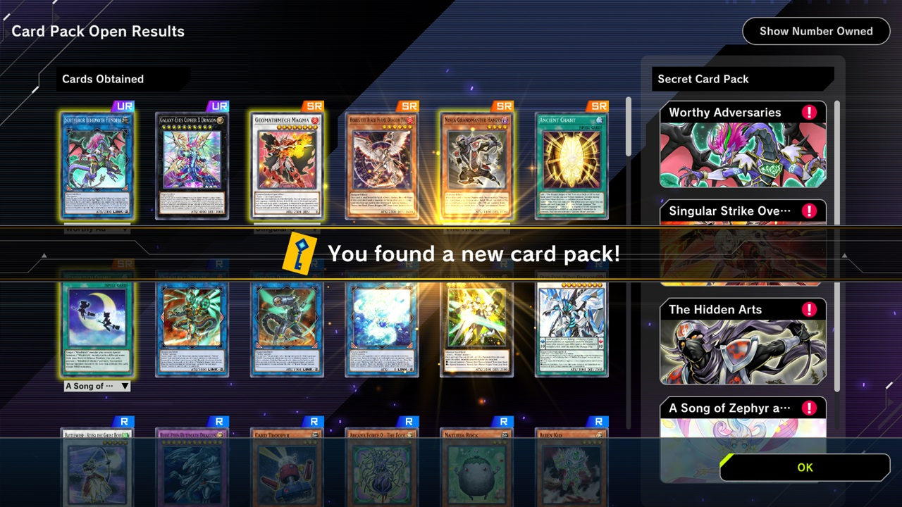
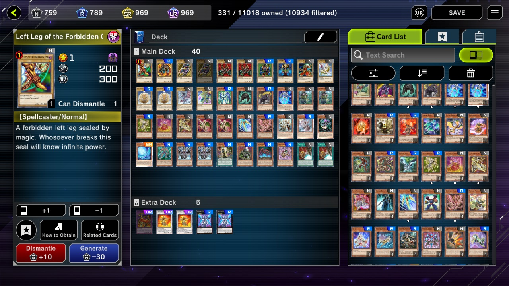
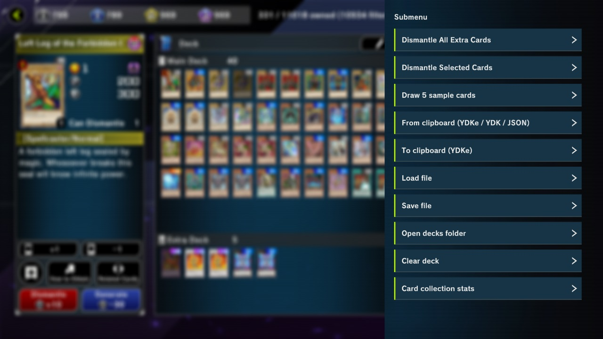
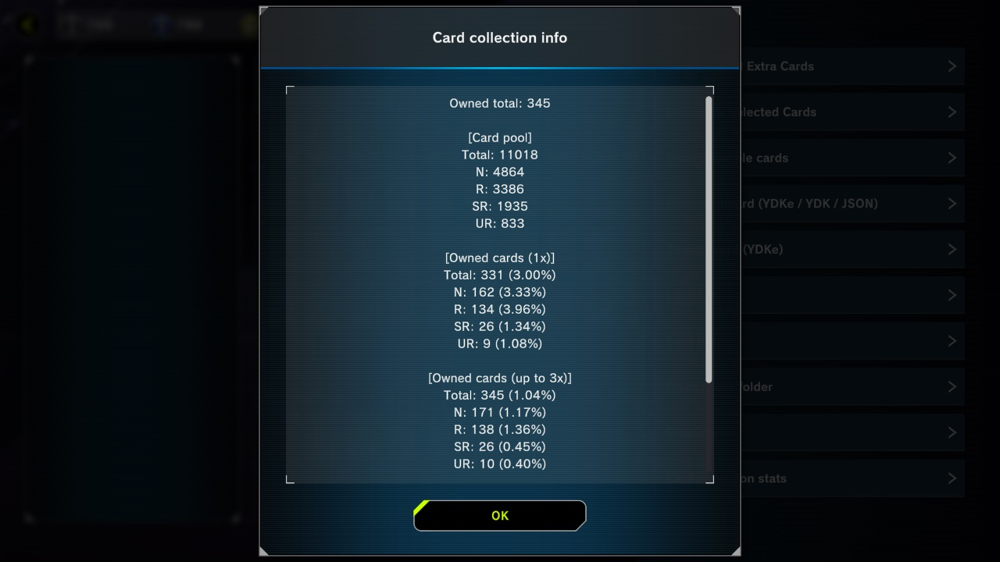
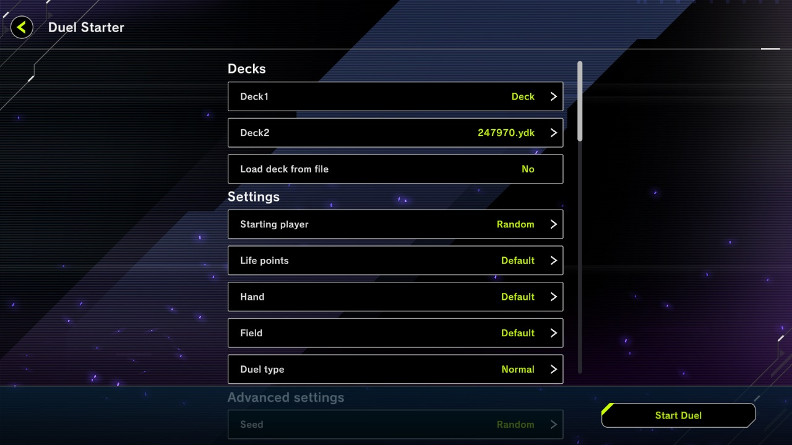
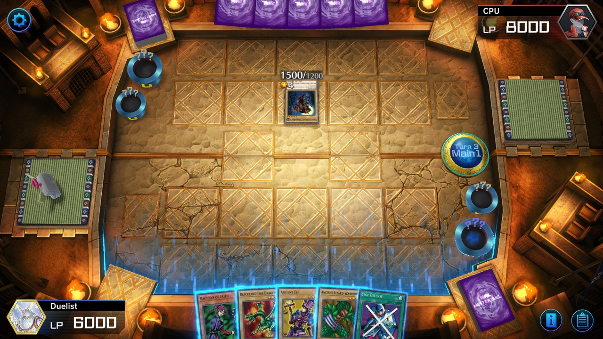

# YgoMaster-Arabic

نسخة معرّبة من [YgoMaster](https://github.com/pixeltris/YgoMaster) لتشغيل Yu-Gi-Oh! Master Duel على PC بدون اتصال، مع تعريب أسماء البطاقات وتأثيراتها ودعم خطوط عربية.

هذا مستودع مستقل مبني على الكود الأصلي لـ **pixeltris** (رخصة MIT). أضاف **braky** التعريب والأدوات التالية:

- تبويب **العربية (Arabic)** داخل المشغّل لتثبيت حزمة التعريب أو إزالتها، مع نسخ احتياطي تلقائي للنص الإنجليزي.
- توليد ملفات البطاقات العربية (`CARD_Name` / `CARD_Desc` / `CARD_Indx`) بعد تشكيل الحروف وترتيب الاتجاه.
- دعم خطوط عربية في واجهة اللعبة (`ArabicCardText` / `ArabicFont`).
- أدوات جمع البيانات وتوليد الحزمة في [`tools/ArabScraper`](tools/ArabScraper).

*التقدّم لا يُشارك مع اللعبة الرسمية.*

## روابط

- [دليل الاستخدام بالعربية](Docs/Arabic.md)
- [المشروع الأصلي](https://github.com/pixeltris/YgoMaster)
- [الترخيص](LICENSE) — [الاعتمادات وحقوق البيانات](NOTICE.md)

## البناء من المصدر

- ثبّت Visual Studio مع C++ compilers و.NET Framework 4.8
- شغّل `Build.bat`
- انسخ مجلد `YgoMaster` الناتج إلى مجلد اللعبة كما هو موضح في [دليل العربية](Docs/Arabic.md)

---

# YgoMaster (upstream)

Offline Yu-Gi-Oh! Master Duel (PC)

*Progress is not shared with the live game.*

## Features

- Create decks
- Open packs
- Solo content
- Custom CPU duels
- [PvP duels / friends / trading](Docs/PvP.md)
- Duel replays
- YDK / YDKe support
- Card collection stats / deck editor sub menu improvements

## Requirements

- .NET Framework 4.8
- The game downloaded on Steam (complete the in-game tutorial to download all data)

YgoMaster is portable and can be used on any machine without Steam installed after being fully downloaded

## Usage

- Download the latest release from https://github.com/pixeltris/YgoMaster/releases
- Copy the `YgoMaster` folder (the folder, not the contents of the folder) into the game folder
- Run `YgoMasterClient.exe` (this should also auto run `YgoMaster.exe`)
- *[If you see file load error popups, infinite loading screens, corrupt screens, etc follow these instructions](Docs/FileLoadError.md)*

Additionally...

- [It's recommended that you tailor the server settings to your preferences](Docs/Settings.md)
- Download [VG.TCG.Decks.7z](https://github.com/pixeltris/YgoMaster/releases/download/v1.4/VG.TCG.Decks.7z) for ~6000 decks from the YGO video games
- The custom duel starter UI can be accessed using the DUEL button on the home screen
- When updating copy your `/YgoMaster/Data/Players/` folder
- [How to change language](Docs/ChangingLanguage.md)
- [How to run on Linux](Docs/Linux.md)

## Compiling from source

- Install Visual Studio with C++ compilers
- Run `Build.bat`
- Copy the `YgoMaster` folder into the game folder as mentioned above

Running `Build.bat` is the equivilant of:

- Compiling `YgoMaster.sln` with Visual Studio
- Compiling `YgoMasterLoader.cpp` with `cl`

## Related

- https://www.nexusmods.com/yugiohmasterduel/mods - community mods
- https://www.nexusmods.com/yugiohmasterduel/articles/3 - modding guide
- https://github.com/SethPDA/MasterDuel-Modding/wiki - modding guide
- https://github.com/crazydoomy/MD-Replay-Editor - save / load replays
- https://github.com/Nauder/ygomd-rush-frames - Rush Duel card frames mod
- https://code.moenext.com/sherry_chaos/MDPro3 - forked YGOPro2 with Master Duel assets

## Screenshots

